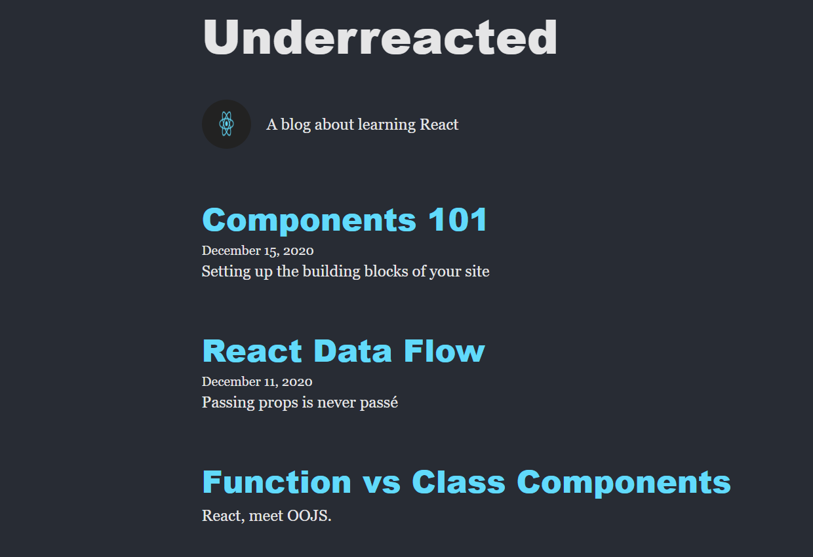

# Underreacted: Blog Site

A static personal blog built with React and Vite to practice components, JSX, and passing data down as props.

## Getting Started

```bash
npm install     # install dependencies
npm run dev     # start the dev server (usually http://localhost:5173)
npm test        # run the Vitest test suite
```

## Screenshot



## Component Tree

```
App
├── Header
├── About
└── ArticleList
    └── Article
```

## Components

| Component | Element | Props | Connected to |
|-----------|---------|-------|--------------|
| `App` | `<div>` | none (imports `blogData` from `data/blog.js`) | Parent of Header, About, ArticleList |
| `Header` | `<header>` with an `<h1>` | `name` | Child of App |
| `About` | `<aside>` with an `` and `<p>` | `image` (defaults to a placeholder), `about` | Child of App |
| `ArticleList` | `<main>` | `posts` | Child of App, parent of Article |
| `Article` | `<article>` with `<h3>`, `<small>`, `<span>`, `<p>` | `title`, `date` (defaults to January 1, 1970), `preview`, `minutes` | Child of ArticleList |

## Data Flow

`App` imports the blog data and passes it down as props. `ArticleList` maps over `posts` and renders one `Article` per post, each with a unique `key` (the post `id`).

## Bonus: Minutes to Read

Each article shows a reading-time indicator:

- Under 30 minutes: one ☕ for every 5 minutes (rounded up)
- 30 minutes or more: one 🍱 for every 10 minutes (rounded up)

## Testing

Tests live in `src/__tests__/` and verify that each component renders the correct elements, that props update the content, and that default values are used when props are missing.